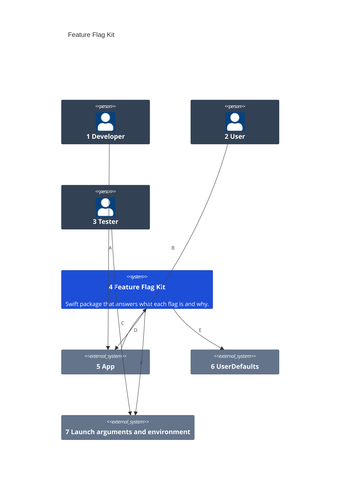
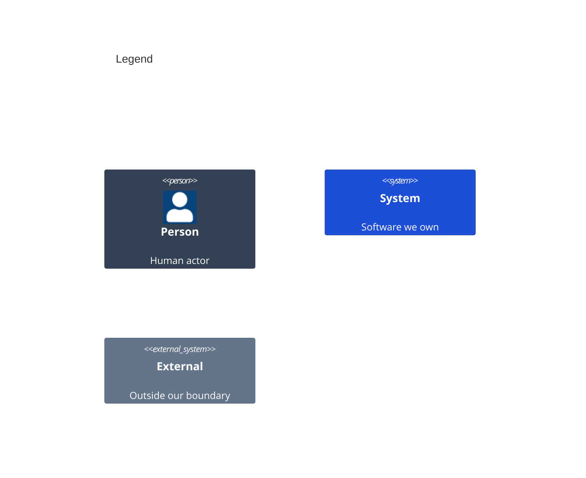

# System Context

Numbers on nodes and letters on arrows match the callout table.

| #   | Description | Why |
| --- | --- | --- |
| 1   | Defines each flag once and gates features on it. | The app keeps its own flag list; the kit supplies the machinery. |
| 2   | Turns a flag on or off in the app's Settings. | The user's own choice stays theirs. |
| 3   | Forces a flag for a test or a manual run. | Overrides leave the user's toggle untouched. |
| 4   | The `FeatureFlagKit` product. | No UI and no XCTest, so the app can ship it. |
| 5   | The app that depends on the kit. | It reads flags to decide what to show. |
| 6   | Holds the user's toggles, under `flag.<name>` or an older key. | Toggles from an earlier release keep working. |
| 7   | Carries `-flag.<name> <value>` and `FLAG_<NAME>` overrides. | A launch sets them without a rebuild. |
| A   | Lists the app's flags and reads them where a feature is gated. | One typed definition replaces repeated defaults. |
| B   | Flips a toggle in Settings. | The toggle writes through the kit. |
| C   | Launches the app with overrides. | Tests and manual runs need no code change. |
| D   | Asks for a flag's value and where it came from. | Precedence lives in one place. |
| E   | Reads and writes the user's toggles. | `UserDefaults` is where apps already keep them. |
| F   | Reads overrides at launch. | Launch argument wins, then environment. |
