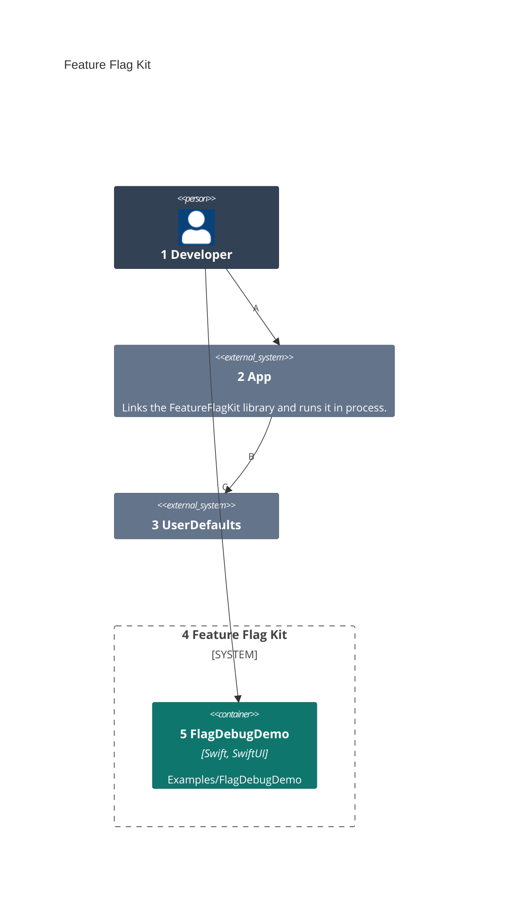
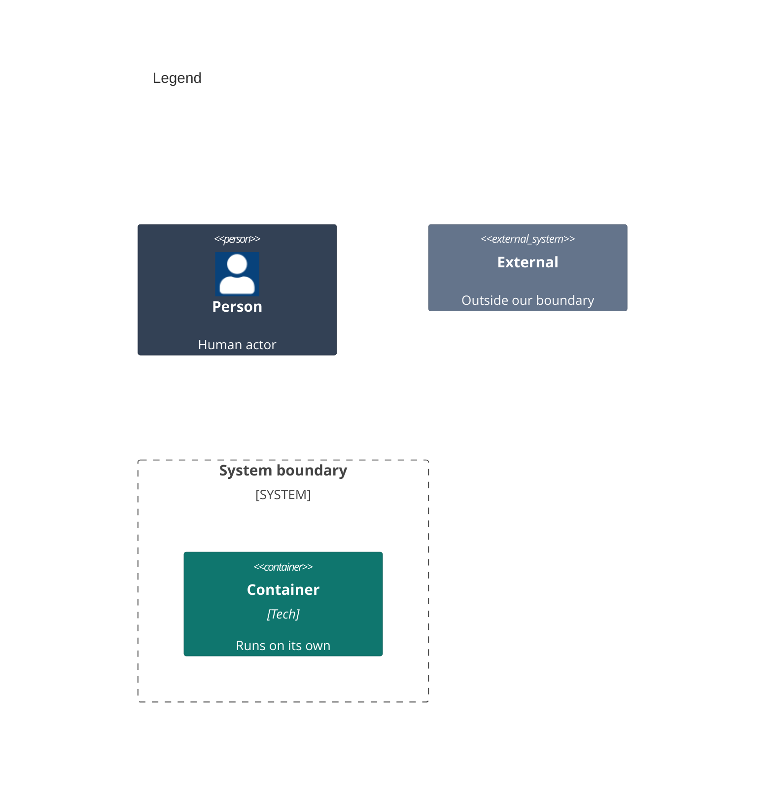

# Containers

A container here is a unit that runs on its own. The kit is a library, so it runs inside the app; [03-components.md](03-components.md) shows its parts. Its one container is the example app.

Numbers on nodes and letters on arrows match the callout table.

| #   | Description | Why |
| --- | --- | --- |
| 1   | The developer from the system context. | They add the kit to an app. |
| 2   | The app process the library runs in. | A library is no runnable unit of its own. |
| 3   | Holds the user's toggles on the device. | The app already keeps settings there. |
| 4   | The repository's own code. | Only the demo runs on its own. |
| 5   | The example iOS app that shows the debug screen and its storybook. | It is the one place StorybookKit is linked. |
| A   | The developer builds and runs the app. | The kit is a dependency, not a tool. |
| B   | The app's linked library reads and writes toggles. | Toggles outlive a launch. |
| C   | The developer runs the demo, or `make screenshots` does. | The README's pictures come from it. |
