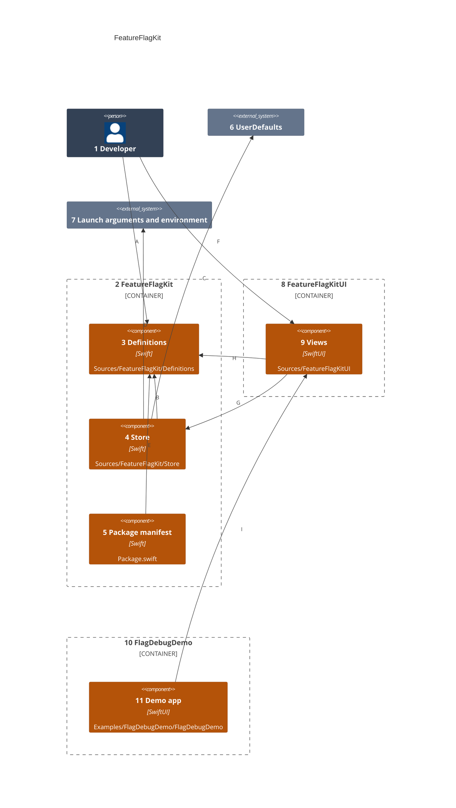
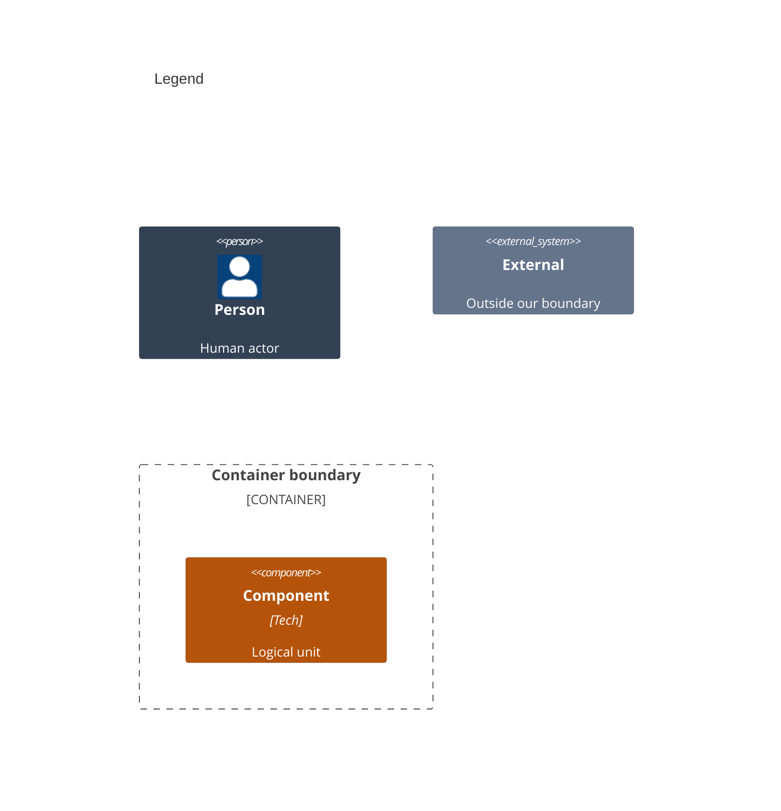

# Components

This splits the library in [02-containers.md](02-containers.md) into its folders. An app defines flags, then asks the store for each value, directly or through the SwiftUI views.

Numbers on nodes and letters on arrows match the callout table.

| #   | Description | Why |
| --- | --- | --- |
| 1   | The developer who lists the app's flags. | Each app keeps its own list. |
| 2   | The core library. | It holds no UI and no XCTest. |
| 3   | A flag, its value types, its expiry day, the catalog and the override encoding. | The definition is the one place a default lives. |
| 4   | The store, its sources and the settings it writes. | Precedence lives in one place. |
| 5   | `Package.swift`, which names both products and their platforms. | It states Swift 6, iOS 26 and macOS 26. |
| 6   | Holds the user's toggles. | Apps already keep toggles there. |
| 7   | Carries the overrides a launch sets. | Tests and manual runs need no rebuild. |
| 8   | The SwiftUI library. | SwiftUI stays out of the core. |
| 9   | The `flagStore` environment value, `@FlagState` and `FlagDebugView`. | One place for SwiftUI. |
| 10  | The example iOS app, which alone links StorybookKit. | Apps that add the kit never inherit the storybook. |
| 11  | Opens the storybook, or with `--storybook "<story name>"` one story. | Each state is seen without tapping to it. |
| A   | Defines each flag once. | One typed definition replaces repeated defaults. |
| B   | Resolves a flag from its definition. | The default is the last resort. |
| C   | Reads and writes the user's toggles. | Older keys keep working. |
| D   | Reads overrides at launch. | The launch argument wins over the environment. |
| E   | Builds each library from its sources. | Each target is its own product. |
| F   | Reads flags in views and opens the debug screen. | The app picks the gesture that opens it. |
| G   | Resolves, sets and resets flags, and hears their changes. | Views redraw when a toggle changes. |
| H   | Reads each flag's definition and the catalog. | The debug screen walks the app's list. |
| I   | Lists the previews FeatureFlagKitUI declares. | The storybook shows these previews. |
