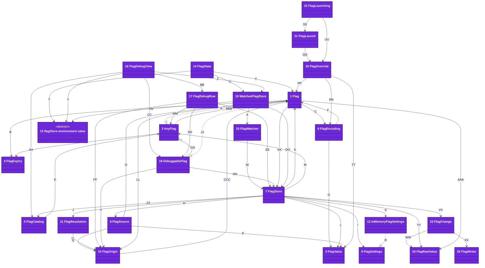
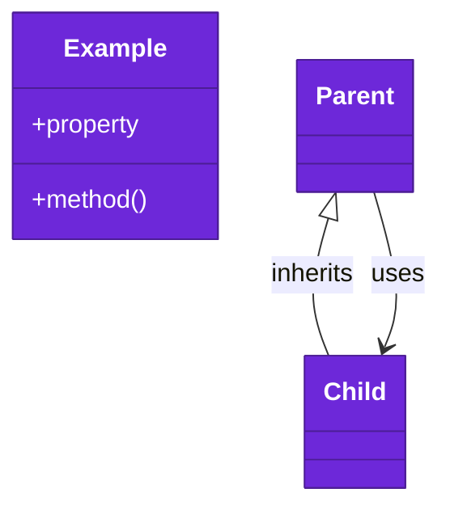

# Code

The `FeatureFlagKit` target lives under `Sources/FeatureFlagKit/`. It imports Foundation only, so an app can ship it. The `FeatureFlagKitUI` target, classes 13 to 19, lives under `Sources/FeatureFlagKitUI/`. It imports the core and SwiftUI only.

The `FeatureFlagKitTesting` target, classes 20 to 22, lives under `Sources/FeatureFlagKitTesting/`. It imports the core and XCTest only.

Numbers on classes and letters on relationships match the callout table. See [02-containers.md](02-containers.md) and [03-components.md](03-components.md).

| #   | Description | Why |
| --- | --- | --- |
| 1   | [`Flag`](../../Sources/FeatureFlagKit/Definitions/Flag.swift) is one flag: name, compiled default, title, settings key and expiry day, `never` for a permanent setting, and a `Bool` flag's parent. | Each flag is defined once, with its group one level deep. |
| 2   | [`AnyFlag`](../../Sources/FeatureFlagKit/Definitions/Flag.swift) is what every flag states, whatever value it holds. | A catalog lists flags of mixed types. |
| 3   | [`FlagValue`](../../Sources/FeatureFlagKit/Definitions/FlagValue.swift) is a type a flag holds: `Bool`, `Int`, `Double`, `String` or an enum with a `String` raw value. | Overrides arrive as text and toggles as stored values. |
| 4   | [`FlagExpiry`](../../Sources/FeatureFlagKit/Definitions/FlagExpiry.swift) is the day a flag should be gone, from its start in UTC, or `never`. | Every machine agrees on the day. |
| 5   | [`FlagCatalog`](../../Sources/FeatureFlagKit/Definitions/FlagCatalog.swift) is the app's list of flags, with `expired(asOf:)` and `grouped`, each child under its parent. | An app test fails once a flag outstays its day. |
| 6   | [`FlagEncoding`](../../Sources/FeatureFlagKit/Definitions/FlagEncoding.swift) spells `-flag.<name>`, `FLAG_<NAME>` and `flag.<name>`. | Every target reads one encoding. |
| 7   | [`FlagStore`](../../Sources/FeatureFlagKit/Store/FlagStore.swift) resolves a flag through its parent, its sources, then the default, streams changes and imports the user's values. | Precedence lives in one place. |
| 8   | [`FlagSource`](../../Sources/FeatureFlagKit/Store/FlagSource.swift) is one place a value comes from: launch arguments, environment or settings. | A later source can join without changing the store. |
| 9   | [`FlagSettings`](../../Sources/FeatureFlagKit/Store/FlagSettings.swift) is the small key-value protocol that `UserDefaults` conforms to. | A test swaps memory in for the app's settings. |
| 10  | [`FlagOrigin`](../../Sources/FeatureFlagKit/Store/FlagOrigin.swift) names where a value came from. | A debug screen can say why a flag is on. |
| 11  | [`FlagResolution`](../../Sources/FeatureFlagKit/Store/FlagOrigin.swift) pairs a value with its origin. | The value and its origin travel together. |
| 12  | [`InMemoryFlagSettings`](../../Sources/FeatureFlagKit/Store/FlagSettings.swift) keeps toggles in memory. | A test gets fresh toggles with nothing to wipe. |
| 13  | [`flagStore`](../../Sources/FeatureFlagKitUI/FlagStoreEnvironment.swift) is the environment's store, `FlagStore.live()` by default. | A preview or test swaps in its own store. |
| 14  | [`FlagState`](../../Sources/FeatureFlagKitUI/FlagState.swift) is the `@FlagState` property wrapper, with `$binding` for the user's toggle. | A view reads a flag in one line. |
| 15  | [`FlagWatcher`](../../Sources/FeatureFlagKitUI/FlagWatcher.swift) counts the store's changes through one callback, with no task waiting between them. | A view that reads the count redraws on each change, and a gesture or scroll beside it is never held up. |
| 16  | [`FlagDebugView`](../../Sources/FeatureFlagKitUI/FlagDebugView.swift) lists the catalog's flags, with "Reset all" behind a confirmation. | One screen says why each flag is on, and a slip clears nothing. |
| 17  | [`FlagDebugRow`](../../Sources/FeatureFlagKitUI/FlagDebugRow.swift) shows a flag's value, layer and expiry day, and its toggle or number field. | An override disables the control and says why. |
| 18  | [`DebuggableFlag`](../../Sources/FeatureFlagKitUI/FlagDebugRow.swift) reads any `Flag` without its value type. | A catalog holds flags of mixed types. |
| 19  | [`WatchedFlagStore`](../../Sources/FeatureFlagKitUI/FlagWatcher.swift) is the environment's store, watched from `update()`. | No view starts a listener while it draws. |
| 20  | [`FlagOverride`](../../Sources/FeatureFlagKitTesting/FlagLaunch.swift) is one flag forced to one value, as launch arguments and environment. | A test names the flag, not its spelling. |
| 21  | [`FlagLaunch`](../../Sources/FeatureFlagKitTesting/FlagLaunch.swift) turns overrides into launch arguments or environment. | A test appends them to its launch. |
| 22  | [`FlagLaunching`](../../Sources/FeatureFlagKitTesting/XCUIApplication+Flags.swift) is an app a UI test launches; `XCUIApplication` conforms. | Its helpers keep the arguments and environment already set. |
| 23  | [`FlagChange`](../../Sources/FeatureFlagKit/Store/FlagChange.swift) is one change to the user's layer: name, key, new value and writer. | A sync hook copies it to another store. |
| 24  | [`FlagRawValue`](../../Sources/FeatureFlagKit/Store/FlagChange.swift) is a stored value that crosses threads and compares equal. | Another store reads and writes property-list values. |
| 25  | [`FlagWriter`](../../Sources/FeatureFlagKit/Store/FlagChange.swift) says whether the app or an import wrote a change. | A sync hook never sends an import back. |
| A   | `Flag` conforms to `AnyFlag`. | The catalog holds any flag. |
| B   | `Flag` carries its expiry day, `never` for a setting. | Expiry is part of the definition. |
| C   | `Flag` asks `FlagEncoding` for its default settings key. | One encoding for all keys. |
| D   | `AnyFlag` exposes the expiry day. | The catalog reads it without the value type. |
| E   | `FlagCatalog` lists flags as `AnyFlag`. | One list per app. |
| F   | `FlagEncoding` builds launch arguments for a flag. | Tests spell overrides one way. |
| G   | `FlagEncoding` writes a value's `flagText` as launch arguments or environment. | The text parses back to the value. |
| H   | `FlagStore` asks each source in order: launch argument, environment, user. | The first source that sets a flag wins. |
| I   | `FlagStore` writes the user's toggle to its settings. | Overrides are never written. |
| J   | `FlagStore` returns a `FlagResolution`. | A caller sees value and origin together. |
| K   | `FlagStore` reads and writes one flag. | The flag names its key and default. |
| L   | `FlagStore` stores a value as a property-list object. | `UserDefaults` reads it back. |
| M   | `FlagStore` resets any flag. | Reset needs no value type. |
| N   | `FlagSource` names its origin. | A debug screen shows it. |
| O   | `FlagSource` reads one flag. | Each source looks up by the flag's name. |
| P   | `FlagSource` parses text or stored values. | Each source returns the flag's own type. |
| Q   | `FlagResolution` holds the origin. | Callers read where it came from. |
| R   | `InMemoryFlagSettings` conforms to `FlagSettings`. | Tests swap it in for `UserDefaults`. |
| S   | `FlagStore.isolated()` builds a store on `InMemoryFlagSettings`. | Each test starts from the defaults. |
| T   | `@FlagState` reads the environment's store. | The app sets the store once. |
| U   | `@FlagState` reads its store through `WatchedFlagStore`, for its own flag. | Only that flag's changes count, and a parent's change names its children too. |
| V   | `@FlagState` wraps one flag definition. | The definition stays the one place a default lives. |
| W   | `FlagWatcher` listens to a store's changes. | Every store over the same settings is heard. |
| X   | `WatchedFlagStore` keeps one `FlagWatcher` and starts it in `update()`. | A store that hears the same changes keeps the listener. |
| Y   | `FlagDebugView` reads the environment's store. | It shows the store the app uses. |
| Z   | `FlagDebugView` reads its store through `WatchedFlagStore`, for every flag. | Every row stays current. |
| AA  | `FlagDebugView` walks the catalog, each child indented under its parent, and resets each flag once the user confirms. | "Reset all" covers the whole list. |
| BB  | `FlagDebugView` passes each row its value and layer. | A changed value redraws the row. |
| CC  | `FlagDebugView` reads each flag through `DebuggableFlag`. | Flags of any value type show. |
| DD  | `FlagDebugRow` reads and changes its flag. | `Bool` flags get a toggle and `Int` flags a number field. |
| EE  | `FlagDebugRow` writes the user's setting to the store. | The user's layer is the one it sets. |
| FF  | `FlagDebugRow` names the layer, or the parent that is off. | An override or an off parent disables the control. |
| GG  | `DebuggableFlag` refines `AnyFlag`. | A row still reads the title and expiry day. |
| HH  | `DebuggableFlag` resolves through the store. | The store's precedence decides. |
| II  | `DebuggableFlag` returns the layer. | The row says where the value came from. |
| JJ  | [`Flag` conforms to `DebuggableFlag`](../../Sources/FeatureFlagKitUI/FlagDebugRow.swift). | Every flag shows without a cast per type. |
| KK  | [`Flag` resolves itself for the debug screen](../../Sources/FeatureFlagKitUI/FlagDebugRow.swift). | The row needs no value type. |
| LL  | [`Flag` returns its layer to the debug screen](../../Sources/FeatureFlagKitUI/FlagDebugRow.swift). | The row names where the value came from. |
| MM  | `FlagDebugRow` shows any flag's title and expiry day. | A flag of the app's own type still shows. |
| NN  | `WatchedFlagStore` reads the environment's store. | One place reads it and watches it. |
| OO  | `WatchedFlagStore` hands its view the store. | The view reads flags through it. |
| PP  | `FlagOverride` takes a flag and a value of its type. | The value parses back to the flag's type. |
| QQ  | `FlagLaunch` reads a list of overrides. | One launch forces several flags. |
| RR  | `FlagOverride` spells itself through `FlagEncoding`. | The store reads what the test wrote. |
| SS  | `FlagLaunching` appends `FlagLaunch` arguments and merges its environment. | A UI test adds overrides in one line. |
| TT  | `FlagOverride` accepts any `FlagValue`. | `flagText` writes it as text its type reads back. |
| UU  | `overrideFlags` takes overrides. | The UI test names flags, not their spelling. |
| VV  | `FlagStore.userChanges(in:)` streams a `FlagChange` for each change to the catalog's user layer. | It hears the same writes as `changes()`. |
| WW  | `FlagChange` holds the new value, or nil when cleared; a value settings cannot hold sends no change. | A sync hook clears the key elsewhere too, and only then. |
| XX  | `FlagChange` names its writer. | Imports are marked. |
| YY  | `FlagStore.importUserValues(_:)` writes raw values by settings key, through each watched flag's type and default. | Values from another store land in the user's layer as `set` would write them. |
| ZZ  | `FlagStore.userChanges(in:)` watches every flag in a catalog. | A sync hook hears flags no view has read. |
| AAA | `Flag` reads an imported raw value as its own type and compares it with its default. | An import writes what `set` would. |
| BBB | `AnyFlag` names the `Flag<Bool>` it sits under, or nil. | A catalog and a debug screen group children under their parent. |
| CCC | `FlagOrigin.parent(_:)` names the parent that is off. | A debug screen says the parent turned the flag off. |

## Platforms

iOS 26 and macOS 26 and later, built with Swift tools 6.2 in the Swift 6 language mode.

## Tests

`swift test` runs every requirement test on the Mac. The 0007 tests stand in a small app for `XCUIApplication`, which runs only in a UI test bundle. Each test owns one acceptance in [docs/requirements](../requirements/) and renders an example screen, or the debug screen, with [apple-ui-testing-library](https://github.com/may-journal/apple-ui-testing-library).
