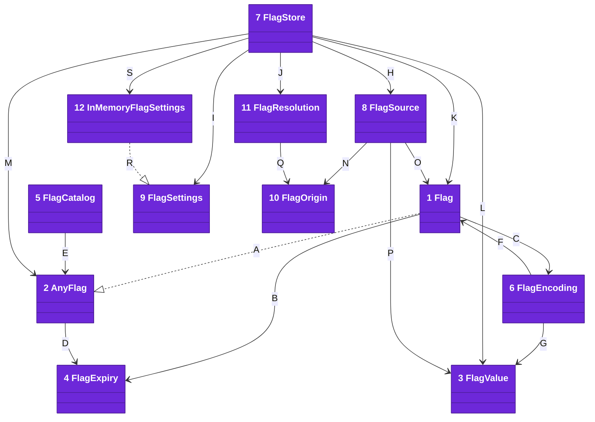
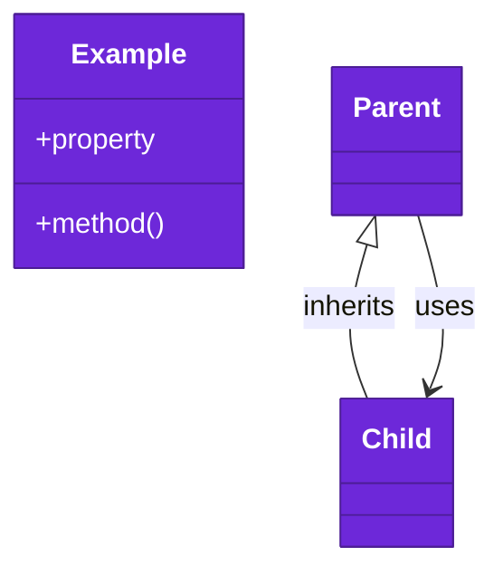

# Code

The `FeatureFlagKit` target lives under `Sources/FeatureFlagKit/`. It imports Foundation only, so an app can ship it.

Numbers on classes and letters on relationships match the callout table. See [02-containers.md](02-containers.md) and [03-components.md](03-components.md).

| #   | Description | Why |
| --- | --- | --- |
| 1   | [`Flag`](../../Sources/FeatureFlagKit/Definitions/Flag.swift) is one flag: name, compiled default, title, expiry day and settings key. | Each flag is defined once. |
| 2   | [`AnyFlag`](../../Sources/FeatureFlagKit/Definitions/Flag.swift) is what every flag states, whatever value it holds. | A catalog lists flags of mixed types. |
| 3   | [`FlagValue`](../../Sources/FeatureFlagKit/Definitions/FlagValue.swift) is a type a flag holds: `Bool`, `Int`, `Double` or `String`. | Overrides arrive as text and toggles as stored values. |
| 4   | [`FlagExpiry`](../../Sources/FeatureFlagKit/Definitions/FlagExpiry.swift) is the day a flag should be gone, from its start in UTC. | Every machine agrees on the day. |
| 5   | [`FlagCatalog`](../../Sources/FeatureFlagKit/Definitions/FlagCatalog.swift) is the app's list of flags, with `expired(asOf:)`. | An app test fails once a flag outstays its day. |
| 6   | [`FlagEncoding`](../../Sources/FeatureFlagKit/Definitions/FlagEncoding.swift) spells `-flag.<name>`, `FLAG_<NAME>` and `flag.<name>`. | Every target reads one encoding. |
| 7   | [`FlagStore`](../../Sources/FeatureFlagKit/Store/FlagStore.swift) resolves a flag through its sources, then the default, and streams toggle changes. | Precedence lives in one place. |
| 8   | [`FlagSource`](../../Sources/FeatureFlagKit/Store/FlagSource.swift) is one place a value comes from: launch arguments, environment or settings. | A later source can join without changing the store. |
| 9   | [`FlagSettings`](../../Sources/FeatureFlagKit/Store/FlagSettings.swift) is the small key-value protocol that `UserDefaults` conforms to. | A test swaps memory in for the app's settings. |
| 10  | [`FlagOrigin`](../../Sources/FeatureFlagKit/Store/FlagOrigin.swift) names where a value came from. | A debug screen can say why a flag is on. |
| 11  | [`FlagResolution`](../../Sources/FeatureFlagKit/Store/FlagOrigin.swift) pairs a value with its origin. | The value and its origin travel together. |
| 12  | [`InMemoryFlagSettings`](../../Sources/FeatureFlagKit/Store/FlagSettings.swift) keeps toggles in memory. | A test gets fresh toggles with nothing to wipe. |
| A   | `Flag` conforms to `AnyFlag`. | The catalog holds any flag. |
| B   | `Flag` carries its expiry day. | Expiry is part of the definition. |
| C   | `Flag` asks `FlagEncoding` for its default settings key. | One encoding for all keys. |
| D   | `AnyFlag` exposes the expiry day. | The catalog reads it without the value type. |
| E   | `FlagCatalog` lists flags as `AnyFlag`. | One list per app. |
| F   | `FlagEncoding` builds launch arguments for a flag. | Tests spell overrides one way. |
| G   | `FlagEncoding` writes a value as launch text. | The text parses back to the value. |
| H   | `FlagStore` asks each source in order: launch argument, environment, user. | The first source that sets a flag wins. |
| I   | `FlagStore` writes the user's toggle to its settings. | Overrides are never written. |
| J   | `FlagStore` returns a `FlagResolution`. | A caller sees value and origin together. |
| K   | `FlagStore` reads and writes one flag. | The flag names its key and default. |
| L   | `FlagStore` stores a value as a property-list object. | `UserDefaults` reads it back. |
| M   | `FlagStore` resets any flag. | Reset needs no value type. |
| N   | `FlagSource` names its origin. | A debug screen shows it. |
| O   | `FlagSource` reads one flag. | Each source looks up by the flag's name. |
| P   | `FlagSource` parses text or stored values. | Each source returns the flag's own type. |
| Q   | `FlagResolution` holds the origin. | Callers read where it came from. |
| R   | `InMemoryFlagSettings` conforms to `FlagSettings`. | Tests swap it in for `UserDefaults`. |
| S   | `FlagStore.isolated()` builds a store on `InMemoryFlagSettings`. | Each test starts from the defaults. |

## Platforms

iOS 26 and macOS 26 and later, built with Swift tools 6.2 in the Swift 6 language mode.

## Tests

`swift test` runs every requirement test on the Mac. Each test owns one acceptance in [docs/requirements](../requirements/) and renders an example screen with [apple-ui-testing-library](https://github.com/may-journal/apple-ui-testing-library).
