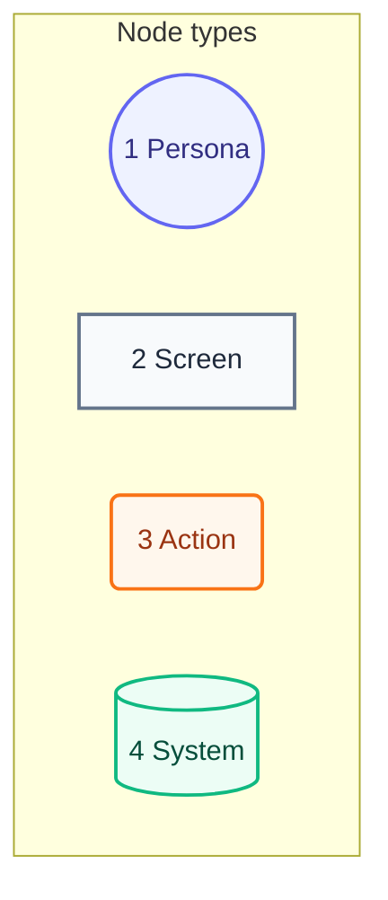
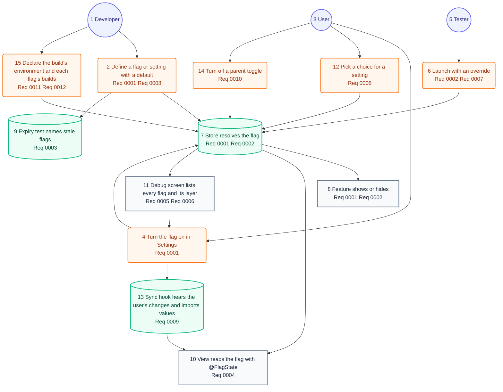

# User Journey

## Legend

Numbers match the callout table.

| #   | Description | Why                                      |
| --- | ----------- | ---------------------------------------- |
| 1   | Persona     | A person the system context declares.    |
| 2   | Screen      | What the person sees.                    |
| 3   | Action      | What the person does.                    |
| 4   | System      | What the product does in reply.          |

## Journey

Numbers match the callout table.

| #   | Description | Type | Why |
| --- | --- | --- | --- |
| 1   | The developer. | Persona | Same person as the system context. |
| 2   | Lists a flag once, in the app's own catalog, with an expiry day unless it is a permanent setting. | Action | The default lives in one place. |
| 3   | The person using the app. | Persona | Same person as the system context. |
| 4   | Flips the flag's toggle. | Action | The user's choice is saved. |
| 5   | The person testing the app. | Persona | Same person as the system context. |
| 6   | Passes a launch argument or environment variable, by hand or from `FlagLaunch`. | Action | A run forces a flag without a rebuild. |
| 7   | Checks the flag ships in this build, then takes the launch argument, variable, toggle and defaults. | System | Precedence lives in one place. |
| 8   | The flagged feature appears only when the flag is on. | Screen | What the user came to see. |
| 9   | Lists the flags past their expiry day, never a setting without one. | System | The app's test fails until they go. |
| 10  | The view redraws when the flag's toggle changes. | Screen | A toggle shows at once. |
| 11  | Shows each flag's value, layer and expiry day, with toggles, number fields and a confirmed "Reset all". | Screen | The user sees why a flag is on. |
| 12  | Picks one of a setting's choices, an enum with a `String` raw value. | Action | A setting needs no code per choice. |
| 13  | Reports each change to the user's layer with its writer, and writes imported values as imports. | System | An app syncs settings without sending imports back. |
| 14  | Turns off a parent, which turns its children off and keeps their own settings. | Action | One switch covers a group and loses no choice. |
| 15  | Sets the Info.plist key per build configuration and lists each flag's environments. | Action | A beta runs for testers and stays off in production. |
